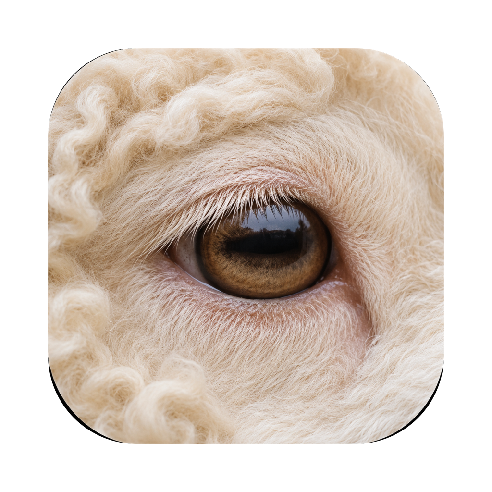
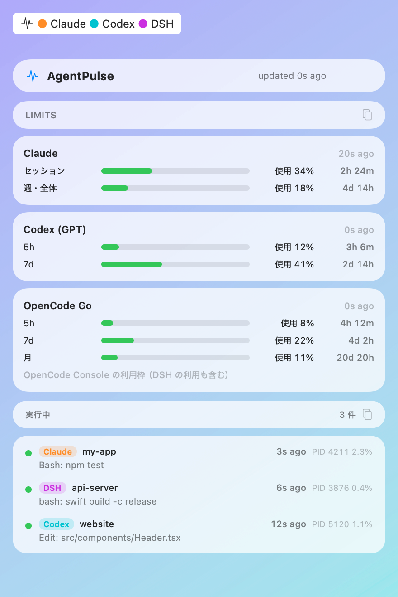

<p align="center">
  
</p>

<h1 align="center">AgentPulse</h1>

**画面に出ていないところで動いている AI エージェントまで、メニューバーで見える化する** macOS アプリです。
あわせて、Claude / Codex / OpenCode Go の使用量もまとめて確認できます。

## 裏で動いているエージェントが見える

AI エージェントは、目の前のターミナル以外でもたくさん動いています。

- ハーネスやスクリプトから呼ばれた **headless 実行**（DSH が opencode を呼ぶ、`opencode run`、`codex exec` など）
- **IDE の拡張機能**（Cursor / VS Code の Claude Code・Codex）
- **デスクトップアプリ**に組み込まれたエージェント（Claude アプリ、ChatGPT アプリの Codex）
- 別のウィンドウや別のデスクトップで動かしたまま忘れているセッション

AgentPulse は、ウィンドウを持たないこうしたエージェントも、プロセスと各ツールのログから見つけ出します。
そして **いまこの瞬間に動いているもの** を、メニューバーにリアルタイムで表示します。

- **メニューバー**: 実行中のエージェントだけを、ツールごとの色で表示します（例: `● Claude ×2  ● DSH`）。
  何も動いていなければアイコンだけになるので、「裏で何かが動いているか」が一目で分かります。
- **ツールチップ**: アイコンにマウスを乗せると、それぞれが **どのフォルダで何をしているか**
  （例: `DSH · my-app — bash: swift build`）が出ます。
- **パネル**: Liquid Glass のカードがデスクトップに浮かぶ、枠のない透明なウィンドウです。
  実行中のエージェントの一覧と作業内容、Claude / Codex (GPT) / OpenCode Go の使用率と
  リセットまでの時間を表示します。行をクリックすると、その作業フォルダを Finder で開きます。



## 対応しているもの

| 種類 | 対象 |
| --- | --- |
| 実行中のエージェント | Claude Code、Codex、OpenCode、DSH (DeepSeek Harness) |
| 使用量 | Claude（サブスクリプション）、Codex / ChatGPT、OpenCode Go |

## 動作環境

- macOS 14 以降（Apple Silicon）
- 表示したいツールが同じ Mac にインストール・ログイン済みであること

## インストール

1. [Releases](../../releases) から最新の `AgentPulse.zip` をダウンロードして展開します。
2. `AgentPulse.app` を「アプリケーション」フォルダに移動します。
3. 初回だけ、Finder で `AgentPulse.app` を **右クリック → 開く** を選びます。

AgentPulse は Apple の公証（notarization）を受けていないため、普通にダブルクリックすると
「開発元を確認できない」と表示されます。右クリックから開くか、次のコマンドで許可してください。

```bash
xattr -dr com.apple.quarantine /Applications/AgentPulse.app
```

ログイン時に自動で起動したい場合は、システム設定 → 一般 → ログイン項目 に追加してください。

## 使い方

- メニューバーのアイコン（波形のマーク）をクリックするとパネルが開きます。
- 起動中に Dock や Launchpad から AgentPulse を開いても、パネルが開きます。
- パネル上部の「AgentPulse」のカプセルをドラッグすると、パネルを好きな場所に移動できます。
- 「Limits」「実行中」の欄をどこでもつかんでパネルの外へドラッグすると、その欄だけを小さなウィンドウで表示できます。
  たとえば実行中のエージェントだけを、画面の隅に常に出しておけます。
- パネルはほかのアプリを使っている間も前面に表示されたままです。
  閉じるには、もう一度アイコンをクリックするか、右上の **×**（または Esc）を押します。
- アイコンにマウスを乗せると、実行中のエージェントの一覧がツールチップで出ます。
- 実行中の行をクリックすると、その作業フォルダを Finder で開きます。
- **設定…** では、表示するサービスの選択や、ガラスの見た目を調整できます。
  設定画面はパネルの隣に開くので、見た目の変化を確かめながら調整できます。
  - **ガラスの種類**: 「標準」または、より背景が透ける「透明」
  - **濃さ**: ガラスに重ねる下地の濃さ。文字が読みにくいときは上げてください
  - ガラスは macOS 26 以降の表現です。それより前の macOS では半透明の素材で表示します。

「実行中」は、ログが 30 秒以内に更新されたもの、またはプロセスが CPU を使っているものです。
待機しているだけの IDE やアプリの補助プロセスは表示しません。

## 使用量の取得元

使用率はすべて「使った割合」で表示します（ChatGPT などの画面は「残り」で表示するため、数字が逆に見えます）。

| サービス | 取得元 | 認証 |
| --- | --- | --- |
| Claude | `GET https://api.anthropic.com/api/oauth/usage`（Claude Code の使用量表示と同じ） | Claude Code の OAuth トークン（`~/.claude/.credentials.json`、なければ macOS のキーチェーン） |
| Codex / GPT | `GET https://chatgpt.com/backend-api/wham/usage`（Codex の `/status` と同じ） | `~/.codex/auth.json` のトークン |
| OpenCode Go | opencode の常駐サービスの `/api/experimental/usage/limits` | `~/.config/opencode/service.json` |

- OpenCode Go の正確な値を出すには、opencode を OpenCode Console にサインインしておく必要があります
  （`opencode auth login opencode`）。未サインインのときは、ローカル DB の記録から推定した値を表示します。
- Claude の API は短時間に何度も呼ぶと制限されるため、問い合わせは 2 分に 1 回までにしています。
  制限を受けたときは最大 30 分まで間隔を空け、その間は前回の値を表示します。
- API が使えないときは、Codex はセッションログ、OpenCode Go はローカル DB の推定に切り替え、その旨を表示します。

**注意**: いずれも各ツールが内部で使っている非公開の API です。予告なく仕様が変わり、
取得できなくなる可能性があります。その場合も、そのカードにエラーが出るだけで、ほかの表示は動き続けます。

## プライバシーと安全性

- 認証情報は **読むだけ** です。トークンの更新や書き戻し、ファイルの書き換えは一切しません。
  トークンの期限が切れているときは、各ツールを起動して更新するよう表示します。
- 通信先は上の表の 2 つの公式ドメイン（api.anthropic.com、chatgpt.com）と、
  自分の Mac の中で動いている opencode サービス（127.0.0.1）だけです。
- トークンは画面にもログにも出しません。データを外部に送ったり保存したりもしません
  （Claude の前回値と次の問い合わせ時刻だけ、アプリ自身の設定領域に保存します）。

## 実行中のエージェントの検出方法

| ツール | 読むもの |
| --- | --- |
| Claude Code | `~/.claude/projects/*/*.jsonl` の末尾 |
| Codex | `~/.codex/sessions/**/rollout-*.jsonl` の末尾 |
| OpenCode | `~/.local/share/opencode/opencode.db`（読み取り専用） |
| DSH | `~/.dsh/sessions/**/session.v4.jsonl.zstd`（`zstd` が必要） |

あわせて `ps` と `lsof` でプロセスを検出し、ログと作業フォルダで紐づけます。

## ソースからビルドする

Xcode（または Swift 6 のツールチェーン）が必要です。

```bash
git clone https://github.com/nijirow12/AgentPulse.git
cd AgentPulse
swift test                  # 単体テスト
bash scripts/build_app.sh   # build/AgentPulse.app を作成（アドホック署名）
open build/AgentPulse.app
```

開発用に、パネルの見た目を画像に書き出すこともできます（実行のたびに各 API を 1 回呼びます）。

```bash
build/AgentPulse.app/Contents/MacOS/AgentPulse --snapshot /tmp/agentpulse.png
```

アプリアイコンは `Resources/AppIcon-source.png` から `swift scripts/make_icon.swift` で
`Resources/AppIcon.png` を作り、`build_app.sh` が `.icns` に変換して同梱します。

## 構成

```
Sources/
  AgentPulseCore/   # 取得・解析ロジック（UI に依存しない、テスト対象）
    Limits/         # Claude / Codex / OpenCode Go の使用量
    Activity/       # 各ツールの実行状況の収集と統合
    Util/           # ファイル末尾の読み込み、プロセス実行、SQLite など
  AgentPulse/       # メニューバー、パネル、設定画面
Tests/              # 単体テスト
scripts/            # .app の組み立て、アイコン生成
docs/               # 設計メモ（SPEC.md / IMPLEMENTATION_PLAN.md）
```

## ライセンス

[MIT](LICENSE)
