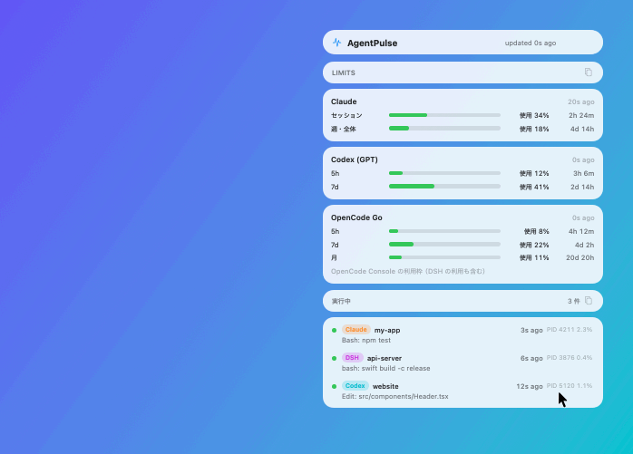

<p align="center">
  
</p>

<h1 align="center">AgentPulse</h1>

<p align="center">
  <b>See the AI agents working behind the scenes — right from your Mac's menu bar.</b><br>
  画面に出ていないところで動いている AI エージェントまで、メニューバーで見える化する macOS アプリ。
</p>

<p align="center">
  <a href="#english">English</a> · <a href="#日本語">日本語</a>
</p>

<p align="center">
  
</p>

<p align="center">
  
</p>

## English

AgentPulse is a menu bar app that shows **which AI coding agents are running right now** —
including the ones you cannot see — and how much of your **Claude / Codex / OpenCode Go** usage is left.

### Agents running behind the scenes

AI agents do a lot of work outside the terminal in front of you:

- **Headless runs** started by harnesses or scripts (DSH calling opencode, `opencode run`, `codex exec`, …)
- **IDE extensions** (Claude Code and Codex in Cursor / VS Code)
- Agents built into **desktop apps** (the Claude app, Codex in the ChatGPT app)
- Sessions left running in another window or on another desktop

AgentPulse finds these window-less agents from their processes and each tool's logs, and shows
**what is running at this moment** in the menu bar.

- **Menu bar**: only the agents that are working, in each tool's colour (e.g. `● Claude ×2  ● DSH`).
  When nothing is running, only the icon remains — so you can tell at a glance whether anything is busy.
- **Tooltip**: hover the icon to see **where each agent is and what it is doing**
  (e.g. `DSH · my-app — bash: swift build`).
- **Panel**: a frameless, transparent window of floating glass cards: the running agents and what they are doing,
  plus Claude / Codex (GPT) / OpenCode Go usage and time until reset. Click a row to open its folder in Finder.
- **Tear-off windows**: drag the Limits or Running section out of the panel to keep just that section
  in its own small window, e.g. the running agents in a corner of the screen.

### Supported

| | |
| --- | --- |
| Running agents | Claude Code, Codex, OpenCode, DSH (DeepSeek Harness) |
| Usage | Claude (subscription), Codex / ChatGPT, OpenCode Go |

### Requirements

- macOS 14 or later (Apple Silicon)
- The tools you want to see, installed and signed in on the same Mac

### Install

1. Download the latest `AgentPulse.zip` from [Releases](../../releases) and unzip it.
2. Move `AgentPulse.app` to your Applications folder.
3. The first time, **right-click `AgentPulse.app` → Open** in Finder.

AgentPulse is not notarized by Apple, so a double-click says the developer cannot be verified.
Open it from the right-click menu, or allow it with:

```bash
xattr -dr com.apple.quarantine /Applications/AgentPulse.app
```

To open it at login, turn on **Settings… → Startup → Open at login**.

### Usage

- Click the menu bar icon (the pulse mark) to open the panel. Opening AgentPulse from the Dock or
  Launchpad while it runs opens the panel too.
- Drag the “AgentPulse” capsule at the top to move the panel.
- The panel stays in front while you use other apps. Close it with the icon, the **×**, or Esc.
- **Settings…** opens next to the panel, so you can watch appearance changes as you make them:
  - **Renderer**: *Stable* (default) is a frosted material whose look never changes, whichever app you use;
    *Liquid Glass* is macOS's own glass with edge refraction, but macOS fogs it while another app is in use.
  - **Glass**: *Clear* (default) or the more frosted *Regular*
  - **Transparency**: how thin the glass is — higher shows more of what is behind it
  - **Backing**: a solid layer under the content; raise it if text is hard to read
  - Glass needs macOS 26 or later; older systems show a translucent material.

“Running” means the agent's log changed in the last 30 seconds, or its process is using the CPU.
IDE and app helpers that are only idling are not shown.

### Where usage comes from

All figures show **how much is used** (ChatGPT and others show what is *left*, so their numbers look reversed).

| Service | Source | Credentials |
| --- | --- | --- |
| Claude | `GET https://api.anthropic.com/api/oauth/usage` (what Claude Code shows) | Claude Code's OAuth token (`~/.claude/.credentials.json`, else the macOS keychain) |
| Codex / GPT | `GET https://chatgpt.com/backend-api/wham/usage` (what Codex `/status` shows) | the token in `~/.codex/auth.json` |
| OpenCode Go | the local opencode service's `/api/experimental/usage/limits` | `~/.config/opencode/service.json` |

- For exact OpenCode Go figures, sign opencode in to OpenCode Console (`opencode auth login opencode`);
  otherwise AgentPulse estimates them from the local database.
- The Claude API rate-limits quickly, so it is asked at most every 2 minutes, backing off up to 30 minutes
  (showing the last figures meanwhile).
- When an API cannot be reached, Codex falls back to its session logs and OpenCode Go to the estimate, and says so.

**Note**: these are internal, undocumented APIs of each tool. They can change without notice; if one breaks,
only that card shows an error.

### Privacy and safety

- Credentials are **only ever read** — never refreshed, written back, or modified. When a token has expired,
  AgentPulse asks you to open that tool so it refreshes it.
- It talks only to the two official domains above (api.anthropic.com, chatgpt.com) and to the opencode service
  on your own Mac (127.0.0.1).
- Tokens are never shown or logged, and no data is sent or stored elsewhere (only the last Claude figures and
  the next request time are kept in the app's own preferences).

### Known issue

- While another app is in use, the panel's glass can look fogged. What AgentPulse draws does not change,
  so this appears to come from how macOS renders inactive apps.

### Build from source

Requires Xcode (or a Swift 6 toolchain).

```bash
git clone https://github.com/nijirow12/AgentPulse.git
cd AgentPulse
swift test                  # unit tests
bash scripts/build_app.sh   # builds build/AgentPulse.app (ad-hoc signed)
open build/AgentPulse.app
```

The README images are drawn from the app's real views with made-up data (no API calls):

```bash
build/AgentPulse.app/Contents/MacOS/AgentPulse --snapshot docs/screenshot.png --demo
build/AgentPulse.app/Contents/MacOS/AgentPulse --demo-gif docs/tear-off.gif
```

## 日本語

> エージェントは、もうターミナルの中だけに棲んではいない。
> IDE の縁で、デスクトップアプリの奥で、ハーネスが呼び出す連鎖の先で、誰にも見られずに計算を続けている。
> 見えない計算は、存在しない計算と区別がつかない。
> AgentPulse は、その不可視の労働を、メニューバーという最小の窓に写像する装置だ。
> 残量がガラス越しに透けて見えること、それ自体がインターフェースの解像度を一段上げる。

**画面に出ていないところで動いている AI エージェントまで、メニューバーで見える化する** macOS アプリです。
あわせて、Claude / Codex / OpenCode Go の使用量もまとめて確認できます。

### 裏で動いているエージェントが見える

AI エージェントは、目の前のターミナル以外でもたくさん動いています。

- ハーネスやスクリプトから呼ばれた **headless 実行**（DSH が opencode を呼ぶ、`opencode run`、`codex exec` など）
- **IDE の拡張機能**（Cursor / VS Code の Claude Code・Codex）
- **デスクトップアプリ**に組み込まれたエージェント（Claude アプリ、ChatGPT アプリの Codex）
- 別のウィンドウや別のデスクトップで動かしたまま忘れているセッション

AgentPulse は、ウィンドウを持たないこうしたエージェントも、プロセスと各ツールのログから見つけ出します。
そして **いまこの瞬間に動いているもの** を、メニューバーにリアルタイムで表示します。

- **メニューバー**: 実行中のエージェントだけを、ツールごとの色で表示します（例: `● Claude ×2  ● DSH`）。
  何も動いていなければアイコンだけになるので、「裏で何かが動いているか」が一目で分かります。
- **ツールチップ**: アイコンにマウスを乗せると、それぞれが **どのフォルダで何をしているか**
  （例: `DSH · my-app — bash: swift build`）が出ます。
- **パネル**: Liquid Glass のカードがデスクトップに浮かぶ、枠のない透明なウィンドウです。
  実行中のエージェントの一覧と作業内容、Claude / Codex (GPT) / OpenCode Go の使用率と
  リセットまでの時間を表示します。行をクリックすると、その作業フォルダを Finder で開きます。

「Limits」「実行中」の欄は、ドラッグしてパネルの外に出すと、その欄だけの小さなウィンドウになります。
たとえば実行中のエージェントだけを、画面の隅に常に出しておけます。

### 対応しているもの

| 種類 | 対象 |
| --- | --- |
| 実行中のエージェント | Claude Code、Codex、OpenCode、DSH (DeepSeek Harness) |
| 使用量 | Claude（サブスクリプション）、Codex / ChatGPT、OpenCode Go |

### 動作環境

- macOS 14 以降（Apple Silicon）
- 表示したいツールが同じ Mac にインストール・ログイン済みであること

### インストール

1. [Releases](../../releases) から最新の `AgentPulse.zip` をダウンロードして展開します。
2. `AgentPulse.app` を「アプリケーション」フォルダに移動します。
3. 初回だけ、Finder で `AgentPulse.app` を **右クリック → 開く** を選びます。

AgentPulse は Apple の公証（notarization）を受けていないため、普通にダブルクリックすると
「開発元を確認できない」と表示されます。右クリックから開くか、次のコマンドで許可してください。

```bash
xattr -dr com.apple.quarantine /Applications/AgentPulse.app
```

ログイン時に自動で起動したい場合は、パネルの **設定… → 起動 → ログイン時に起動** をオンにしてください。

### 使い方

- メニューバーのアイコン（波形のマーク）をクリックするとパネルが開きます。
- 起動中に Dock や Launchpad から AgentPulse を開いても、パネルが開きます。
- パネル上部の「AgentPulse」のカプセルをドラッグすると、パネルを好きな場所に移動できます。
- 「Limits」「実行中」の欄をどこでもつかんでパネルの外へドラッグすると、その欄だけを小さなウィンドウで表示できます。
  たとえば実行中のエージェントだけを、画面の隅に常に出しておけます。
- パネルはほかのアプリを使っている間も前面に表示されたままです。
  閉じるには、もう一度アイコンをクリックするか、右上の **×**（または Esc）を押します。
- アイコンにマウスを乗せると、実行中のエージェントの一覧がツールチップで出ます。
- 実行中の行をクリックすると、その作業フォルダを Finder で開きます。
- **設定…** では、表示するサービスの選択や、ガラスの見た目を調整できます。
  設定画面はパネルの隣に開くので、見た目の変化を確かめながら調整できます。
  - **描画方式**: 「安定」（既定）は、どのアプリを操作していても質感が変わらないすりガラス。
    「Liquid Glass」は縁の屈折が出る macOS 本来のガラスですが、ほかのアプリを操作している間は
    macOS によって曇った見た目になります
  - **ガラスの種類**: 「透明」（既定）または、すりガラス寄りの「標準」
  - **透明度**: ガラスそのものの薄さ。上げるほど背景がよく透けます
  - **下地の濃さ**: ガラスに重ねる下地の濃さ。文字が読みにくいときは上げてください
  - ガラスは macOS 26 以降の表現です。それより前の macOS では半透明の素材で表示します。

「実行中」は、ログが 30 秒以内に更新されたもの、またはプロセスが CPU を使っているものです。
待機しているだけの IDE やアプリの補助プロセスは表示しません。

### 使用量の取得元

使用率はすべて「使った割合」で表示します（ChatGPT などの画面は「残り」で表示するため、数字が逆に見えます）。

| サービス | 取得元 | 認証 |
| --- | --- | --- |
| Claude | `GET https://api.anthropic.com/api/oauth/usage`（Claude Code の使用量表示と同じ） | Claude Code の OAuth トークン（`~/.claude/.credentials.json`、なければ macOS のキーチェーン） |
| Codex / GPT | `GET https://chatgpt.com/backend-api/wham/usage`（Codex の `/status` と同じ） | `~/.codex/auth.json` のトークン |
| OpenCode Go | opencode の常駐サービスの `/api/experimental/usage/limits` | `~/.config/opencode/service.json` |

- OpenCode Go の正確な値を出すには、opencode を OpenCode Console にサインインしておく必要があります
  （`opencode auth login opencode`）。未サインインのときは、ローカル DB の記録から推定した値を表示します。
- Claude の API は短時間に何度も呼ぶと制限されるため、問い合わせは 2 分に 1 回までにしています。
  制限を受けたときは最大 30 分まで間隔を空け、その間は前回の値を表示します。
- API が使えないときは、Codex はセッションログ、OpenCode Go はローカル DB の推定に切り替え、その旨を表示します。

**注意**: いずれも各ツールが内部で使っている非公開の API です。予告なく仕様が変わり、
取得できなくなる可能性があります。その場合も、そのカードにエラーが出るだけで、ほかの表示は動き続けます。

### プライバシーと安全性

- 認証情報は **読むだけ** です。トークンの更新や書き戻し、ファイルの書き換えは一切しません。
  トークンの期限が切れているときは、各ツールを起動して更新するよう表示します。
- 通信先は上の表の 2 つの公式ドメイン（api.anthropic.com、chatgpt.com）と、
  自分の Mac の中で動いている opencode サービス（127.0.0.1）だけです。
- トークンは画面にもログにも出しません。データを外部に送ったり保存したりもしません
  （Claude の前回値と次の問い合わせ時刻だけ、アプリ自身の設定領域に保存します）。

### 実行中のエージェントの検出方法

| ツール | 読むもの |
| --- | --- |
| Claude Code | `~/.claude/projects/*/*.jsonl` の末尾 |
| Codex | `~/.codex/sessions/**/rollout-*.jsonl` の末尾 |
| OpenCode | `~/.local/share/opencode/opencode.db`（読み取り専用） |
| DSH | `~/.dsh/sessions/**/session.v4.jsonl.zstd`（`zstd` が必要） |

あわせて `ps` と `lsof` でプロセスを検出し、ログと作業フォルダで紐づけます。

### 既知の問題

- ほかのアプリを操作している間、パネルのガラスが曇ったように見えることがあります。
  アプリが描いている内容は前面のときと変わらないため、macOS 側の表示処理によるものと考えています。

### ソースからビルドする

Xcode（または Swift 6 のツールチェーン）が必要です。

```bash
git clone https://github.com/nijirow12/AgentPulse.git
cd AgentPulse
swift test                  # 単体テスト
bash scripts/build_app.sh   # build/AgentPulse.app を作成（アドホック署名）
open build/AgentPulse.app
```

開発用に、パネルの見た目を画像に書き出すこともできます（実行のたびに各 API を 1 回呼びます）。
`--demo` を付けると、実際のデータの代わりに架空のデータで描きます。

```bash
build/AgentPulse.app/Contents/MacOS/AgentPulse --snapshot /tmp/agentpulse.png
```

README の画像は、次の 2 つで作っています（どちらも架空のデータ、API は呼びません）。

```bash
build/AgentPulse.app/Contents/MacOS/AgentPulse --snapshot docs/screenshot.png --demo
build/AgentPulse.app/Contents/MacOS/AgentPulse --demo-gif docs/tear-off.gif
```

アプリアイコンは `Resources/AppIcon-source.png` から `swift scripts/make_icon.swift` で
`Resources/AppIcon.png` を作り、`build_app.sh` が `.icns` に変換して同梱します。

### 構成

```
Sources/
  AgentPulseCore/   # 取得・解析ロジック（UI に依存しない、テスト対象）
    Limits/         # Claude / Codex / OpenCode Go の使用量
    Activity/       # 各ツールの実行状況の収集と統合
    Util/           # ファイル末尾の読み込み、プロセス実行、SQLite など
  AgentPulse/       # メニューバー、パネル、設定画面
Tests/              # 単体テスト
scripts/            # .app の組み立て、アイコン生成
docs/               # 設計メモ（SPEC.md / IMPLEMENTATION_PLAN.md）
```

## License / ライセンス

[MIT](LICENSE)
